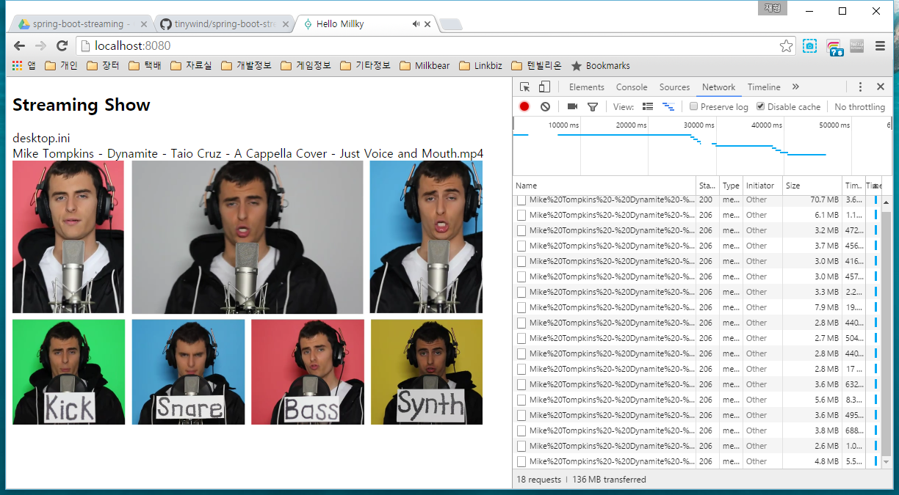

# Video Streaming Service

Browse and stream local MP4 videos in a browser, record timestamped key
annotations during playback, and save the annotations to a database and CSV.
The application uses Spring Boot and a JSP interface.



## Prerequisites

- JDK 17.
- Maven 3.9 or newer.
- An existing directory containing MP4 videos.

## Run from source

From the repository directory, build and check the application:

```bash
mvn verify
```

Start it with the directory you want to browse:

```bash
mvn spring-boot:run -Dspring-boot.run.jvmArguments="-Dvideo.root=/absolute/path/to/videos"
```

Alternatively, run the executable WAR produced by the same build:

```bash
java -Dvideo.root="/absolute/path/to/videos" -jar target/spring-boot-streaming-0.1.war
```

The artifact retains the historical `spring-boot-streaming` name. The old
prebuilt WAR was removed because it contained obsolete dependencies; build the
current application from source.

## Use the application

1. Open [http://localhost:8080/](http://localhost:8080/) after startup. This is the
   default port unless you override Spring Boot's `server.port` setting.
2. Select a directory or MP4 file in the list above the player. The previous-folder
   entry moves up within the configured video root.
3. Use the player buttons or Space to play or pause the selected video.
4. While it is playing, press `Q`, `W`, `E`, `A`, `S`, `D`, `Z`, `X` or `C` to
   append a key annotation at the current playback time. Entries appear below
   the player.
5. Click `SAVE TO CSV` to persist the current annotation batch and download a CSV
   with `timestamp` and `key` columns.

`KEY INSTRUCTION` opens the in-app help dialog. The implemented keyboard controls
are listed here; apart from Space, these controls act while the video is playing.

| Key | Action |
| --- | --- |
| Space | Play or pause. |
| Left / Right arrow | Seek backward or forward by three seconds. |
| Up / Down arrow | Increase or decrease the playback rate by 0.25. |
| `Q W E A S D Z X C` | Append the pressed key and current playback timestamp. |
| Backspace | Remove the last annotation from the current list. |
| `+` / `-` | Increase or decrease video display width in 10% steps, with a 100% minimum. |
| `=` | Restore the video display to 100% width and its original position. |
| Ctrl + arrow | Move the enlarged video within the player area. |

## Video and data boundaries

The configured video directory must exist. Browsing, downloads and range requests
resolve real paths and reject files or directory symlinks outside that directory.
Downloads retain the original filename, including Unicode.

Saved annotations and CSV exports keep the existing schema. CSV exports prefix
formula-leading or control-leading keys with an apostrophe so spreadsheets read
them as text. Stored annotations and ordinary custom keys stay unchanged.

The H2 web console is disabled by default. The application has no user
authentication; keep access within its intended trusted environment.

## Existing database migration

The default database is `spring-boot-streaming` in the process working directory.
H2 2.x cannot directly open old H2 1.4 database files. Before using existing data:

1. Back up the original database.
2. Export it with the old H2 version.
3. Import it into a separate H2 2.x database using `RUNSCRIPT ... FROM_1X`, as
   described in the [H2 migration guide](https://www.h2database.com/html/migration-to-v2.html).
4. Verify the imported annotations before selecting that database.

`NON_KEYWORDS=KEY` in the JDBC URL preserves the existing annotation `key` column;
retain it when supplying a custom URL. The JPA mapping keeps the original
identity columns so new annotations do not collide with imported IDs.

## Development and verification

The application uses Spring Boot 4.1.2, JPA, H2, Lombok, Jakarta JSP/JSTL,
Bootstrap 5.3.8 and jQuery 3.7.1. If your IDE cannot compile Lombok annotations,
check its Lombok and annotation-processing support.

`mvn verify` uses temporary fixture videos, a separate in-memory H2 database and
loopback HTTP requests. It checks range boundaries, path and symlink confinement,
JSP escaping, annotation persistence, CSV output and disabled consoles. It does
not open an existing database or deploy the application.

## Background and references

This project began as a personal spare-time experiment.

- [Spring Boot documentation](https://docs.spring.io/spring-boot/).
- [Original streaming reference](http://millky.com/@origoni/post/1100).
- [Spring Boot streaming tutorial](http://march3samwuli.tistory.com/entry/Step-1-%EC%9D%8C%EC%95%85-%EC%8A%A4%ED%8A%B8%EB%A6%AC%EB%B0%8D-%EC%84%9C%EB%B2%84Spring-boot-%EC%95%B1Android%EC%9D%84-%EB%A7%8C%EB%93%A4%EC%96%B4%EB%B3%B4%EC%9E%90).
- [Additional original reference](http://aodis.egloos.com/5962812).
- [HTML video reference](https://www.w3schools.com/html/html5_video.asp).
- [Historical Microsoft video reference](https://msdn.microsoft.com/ko-kr/library/hh924823(v=vs.85).aspx).
- [Jumping to time offsets in videos](http://gingertech.net/2009/08/19/jumping-to-time-offsets-in-videos/).
- [HTML5 video overview](https://ko.wikipedia.org/wiki/HTML5_%EB%B9%84%EB%94%94%EC%98%A4).

## License

[MIT](LICENSE).
